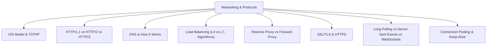
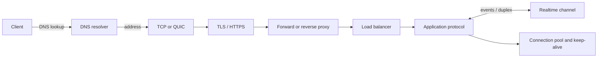

# Networking & Protocols (Module 9)

One self-contained public repository for Module 9. Every roadmap topic has a guide, runnable Java 21 example, a focused JUnit test, explicit trade-offs, and a checked standards or authoritative reference. Simulations run locally and use no external infrastructure.

## Topic map

## Complete topic coverage
| Guide | Runnable example | Test |
|---|---|---|
| [OSI Model & TCP/IP](network-models/README.md) | [Example](network-models/src/main/java/example/Example.java) | [Test](network-models/src/test/java/example/ExampleTest.java) |
| [HTTP/1.1 vs HTTP/2 vs HTTP/3](http-evolution/README.md) | [Example](http-evolution/src/main/java/example/Example.java) | [Test](http-evolution/src/test/java/example/ExampleTest.java) |
| [DNS & How It Works](dns/README.md) | [Example](dns/src/main/java/example/Example.java) | [Test](dns/src/test/java/example/ExampleTest.java) |
| [Load Balancing (L4 vs L7, Algorithms)](load-balancing/README.md) | [Example](load-balancing/src/main/java/example/Example.java) | [Test](load-balancing/src/test/java/example/ExampleTest.java) |
| [Reverse Proxy vs Forward Proxy](proxies/README.md) | [Example](proxies/src/main/java/example/Example.java) | [Test](proxies/src/test/java/example/ExampleTest.java) |
| [SSL/TLS & HTTPS](tls-https/README.md) | [Example](tls-https/src/main/java/example/Example.java) | [Test](tls-https/src/test/java/example/ExampleTest.java) |
| [Long Polling vs Server-Sent Events vs WebSockets](realtime/README.md) | [Example](realtime/src/main/java/example/Example.java) | [Test](realtime/src/test/java/example/ExampleTest.java) |
| [Connection Pooling & Keep-Alive](connections/README.md) | [Example](connections/src/main/java/example/Example.java) | [Test](connections/src/test/java/example/ExampleTest.java) |

## Build and run
Install JDK 21. From the repository root: `./gradlew test`, `./gradlew build`, or `./gradlew :dns:runExample`. Any topic can be run via `./gradlew :<topic>:runExample`. The unified Gradle wrapper is pinned to 9.8.1 and all topic directories use the Java 21 toolchain and JUnit 5.

## Protocol path

## Reference approach
Topic guides cite protocol standards (RFCs and WHATWG) for protocol behavior, plus official platform documentation for implementation details. Each citation states what the source supports.
